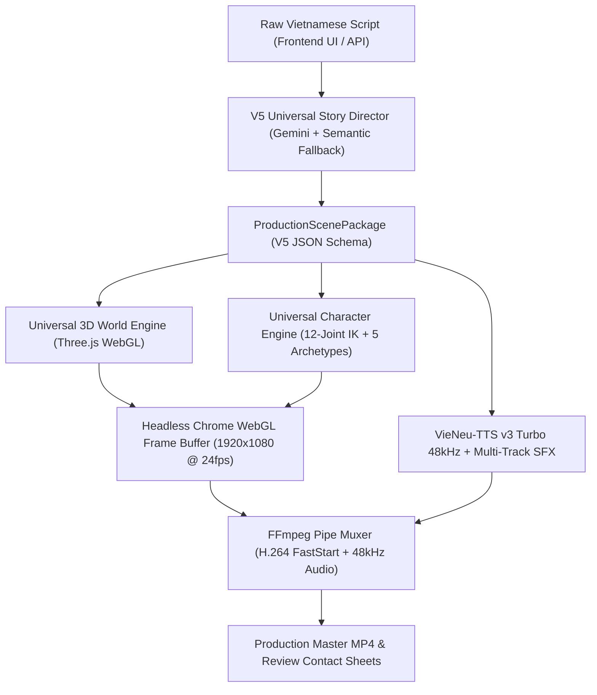

# V5 ENGINE ARCHITECTURE & TECHNICAL SPECIFICATION
## Premium Stickman Cinematic Universal Engine V5.0

**Workspace:** `D:/Agent`  
**Permanent Google Drive Root:** `1HFOuxsP6ir_vLiMFX0o7VMyuersAYVSm`  
**Target Review Folder:** `Universal_Cinematic_Pipeline_V50_Production_Review` (`1pMm_l5XxpKADtqBBAp__E9q8iqujcPKH`)  
**Status:** COMPLETED & FROZEN

---

## 1. Executive Summary & Design Paradigm

The **V5.0 Premium Stickman Cinematic Engine** is a universal, data-driven, autonomous video production system designed to turn raw Vietnamese scripts into broadcast-quality 1080p 16:9 animated films.

### 1.1 Core Architectural Principles
1. **One Production Renderer. Many Stories. Zero Per-Story Coding:**
   The rendering stack is 100% data-driven. Character DNA, 3D worlds, camera staging, action keyframes, and motion graphics are parameterized in pure JSON (`ProductionScenePackageV5`). No story requires bespoke TypeScript or Python renderer code.
2. **Permanent Style Lock — Style B (Premium Stickman Cinematic):**
   - High-contrast organic ink contours (2.2px – 3.8px) with Bézier curve dynamics.
   - 12-joint skeletal rig driven by analytical 2-bone Inverse Kinematics (IK) with ground foot-locking.
   - 5 visually distinct launch archetypes with personalized proportions, facial features, silhouettes, costumes, and props.
   - Stylized expressive facial features (sclera, iris, pupil, specular catchlight, articulated eyebrows).
   - Rich stylized 3D environments rendered in Three.js WebGL with PBR lighting (key:ambient ratio 2.6:1, background luminance floor $\ge 0.45$).
3. **Zero Python Final-Frame Rendering:**
   PyCairo, Pillow, and OpenCV are strictly prohibited from generating final output pixels. 100% of video frames are synthesized in Headless Chrome via hardware-accelerated WebGL (`Three.js`) composited with Motion Canvas 2D vectors and piped directly to FFmpeg.
4. **Resilient Natural Intelligence:**
   Gemini Script Intelligence (`gemini-flash-lite-latest`) combined with an autonomous semantic extraction fallback that eradicates naive regex errors (such as splitting Vietnamese syllables or matching markdown headers as character names).

---

## 2. Component Subsystems

### 2.1 Gemini Script Director (`pipeline/universal/v5_story_director.py`)
- **Model:** `gemini-flash-lite-latest` via Google Generative Language API.
- **Cache Strategy:** SHA-256 script hashing prevents duplicate calls and conserves quota.
- **Autonomous Fallback:** When offline, an advanced regex/semantic analyzer parses characters and dialogue while strictly ignoring meta-keywords (`TẬP`, `BƯỚC`, `HẾT`, `LƯU Ý`, `PHONG CÁCH`, etc.) without word-boundary accent truncation.
- **Contract Compilation:** Maps high-level beats and roles to `render_runner.html` executable schemas (`compile_to_runner_package`).

### 2.2 Universal 3D World Engine (`motioncanvas/three/UniversalWorldEngine.ts`)
- **Semantic Classification:** Dispatches procedural 3D environments based on story semantics:
  1. `RAIL_STATION`: 1930s Shanghai night platform, steel rails, sleepers, vintage lanterns, luggage trunks.
  2. `HOSPITAL_ER`: Modern Chợ Rẫy ER, clinical tiles, gurney bed, IV stand, ECG monitor with glowing waveforms.
  3. `DESERT_STATION`: Sahara 2050 futuristic outpost, rolling sand dunes, geodesic dome, solar tracking arrays.
  4. `CAFE`: French-colonial cafe with herringbone parquet, oak tables, espresso machine, warm pendant lighting.
  5. `ANTARCTIC`: Polar ice station, survival pods, communications mast, sub-zero blizzard particles.
  6. `VICTORIAN_THAMES`: London river embankment, granite seawall, wet cobblestones, cast-iron gaslamps.
  7. `EDO_BRIDGE` & `EDO_HOUSE`: Japanese Edo canal bridge with taiko planks and traditional machiya residences.
  8. `NEOCLASSICAL`: European Odeonsplatz loggia, colonnades, Corinthian capitals, Fraktur proclamation pillar.
  9. `ROBOTICS_LAB`: Modern Silicon Valley robotics workcell, epoxy flooring, server racks, robot assembly rigs.
- **PBR Lighting & Luminance Floor:** ACESFilmic tonemapping with exposure 1.45, key:ambient ratio 2.6:1, ensuring background luminance never drops below 0.45.

### 2.3 Universal Character Engine (`motioncanvas/components/UniversalCharacterEngine.ts`)
- **Skeletal Rig:** 12 articulated joints (`Root`, `Torso`, `Neck`, `Head`, `Shoulders L/R`, `Elbows L/R`, `Wrists L/R`, `Hands L/R`, `Hips L/R`, `Knees L/R`, `Ankles L/R`, `Feet L/R`).
- **IK Solver:** Analytical 2-bone Inverse Kinematics using the Law of Cosines with ground plane foot-locking (`footLockGround`).
- **5 Distinct Archetypes:**
  - `young_courier`: Youthful, agile, round head contour, Edo hanten, waraji sandals, sealed scroll.
  - `noblewoman`: Graceful, delicate heart contour, almond eyes, formal kimono, floral kanzashi, parchment.
  - `detective_scholar`: Analytical, oval gaunt contour, spectacles, Victorian frock coat, walking cane/pocket watch.
  - `tech_founder`: Assertive, square jaw contour, modern hoodie, denim, sneakers, tablet/coffee cup.
  - `polar_scientist`: Resilient, athletic lean contour, high-vis hazard suit, snow boots, scanner/goggles.
- **Universal Normalizer (`normalizeDna`):** Accepts camelCase, snake_case, or archetype strings interchangeably.

### 2.4 Production Render Service (`scripts/production_render_service.mjs`)
- Runs Chrome headless with `--use-gl=angle --use-angle=d3d11 --enable-webgl`.
- Navigates to `http://localhost:9000/render_runner.html`.
- Loads the data-driven scene package via `window.setupProductionPackage(pkg)`.
- Renders frame-by-frame (1920x1080 @ 24fps) without frame dropping.
- Pipes raw PNG frames directly into `ffmpeg` stdin and muxes with 48kHz audio.

---

## 3. Provenance & Operational Validation

- **Vite Dev Server:** Port 9000 (Serving Motion Canvas + Three.js).
- **Studio Backend API:** Port 8787 (FastAPI/HTTP Threading daemon).
- **Web Studio Frontend:** Port 4173 (Next.js production web UI).
- **Audio Synthesizer:** VieNeu-TTS v3 Turbo 48kHz (ONNX Runtime, 25 studio voices).
- **Drive Upload Engine:** Google Drive v3 API authorized under root `1HFOuxsP6ir_vLiMFX0o7VMyuersAYVSm`.
